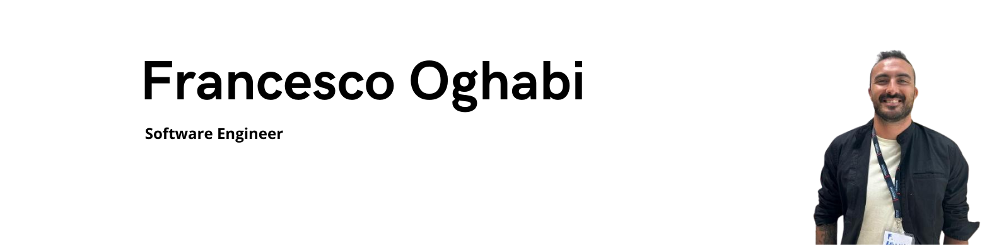

<h1>Say Hi! to my tiny corner of GitHub </h1>
<h4>I work within enterprise architecture, Magento eCommerce and everything that can be coded.</h4>

- [OpenArtemis](https://github.com/francesco-oghabi/artemis): Autonomous AI Penetration Agent Based on Open Weight Models

- [HellfireCloud](https://hellfirecloud.it)

- [Magefleet](https://oghabi.it)

- [Magento-Academy](https://magento-academy.com)

- [My website](https://oghabi.it)

- [Consulenza Magento / Adobe Commerce](https://oghabi.it/it-it/sviluppatore-magento-italia/)

- [Helm repository](https://artifacthub.io/packages/search?user=magefleet&sort=relevance&page=1)

- [My online CV](https://oghabi.it)

- 🔭 I’m currently working on Machine Learning Operations, Security, Kubernetes and Cloud Infrastructure

- 🌱 I’m currently learning **Security** and **CEH**

- 💬 Ask me about **MLOps, Cloud Architecture, Magento Community, Kubernetes Infrastructure, Helm Chart, Docker**

<h3 align="left">Connect with me:</h3>

<h3 align="left">Languages and Tools:</h3>

<a href="https://www.rust-lang.org" target="_blank"> <picture><source media="(prefers-color-scheme: dark)" srcset="https://cdn.simpleicons.org/rust/ffffff"/></picture> </a>

<h3>Some stats for my personal GitHub account:</h3>

 (Work stats not included)

  
Most used languages

  
GitHub stats

